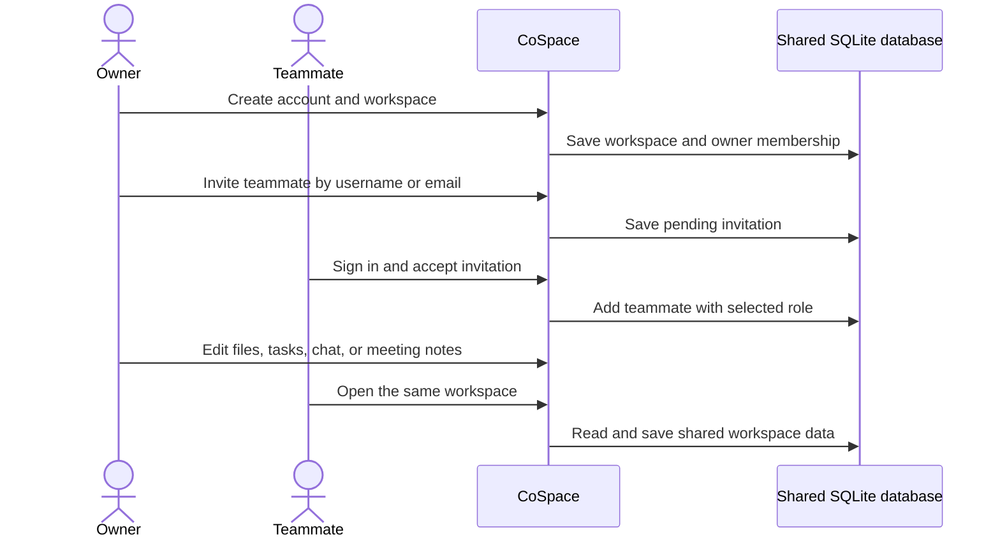
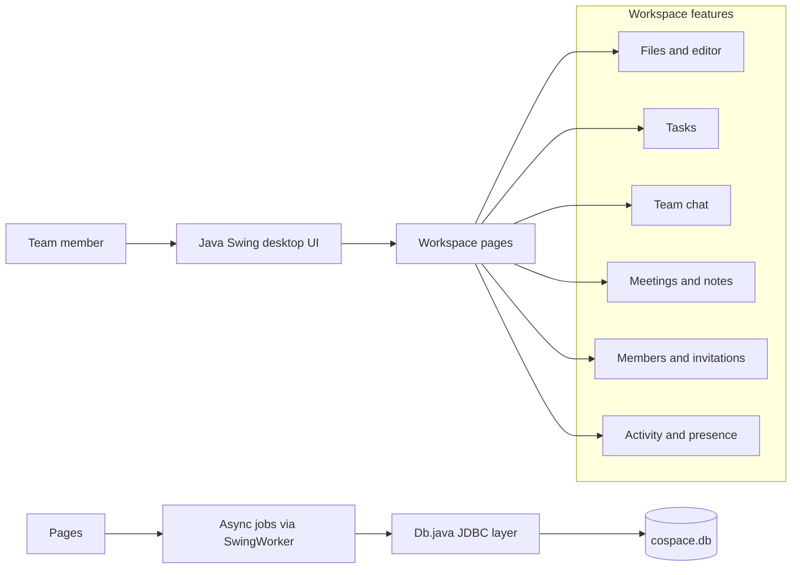

# CoSpace

> **A shared space for getting work done together.**
>
> CoSpace is a Java desktop collaboration app for organizing projects, sharing files and notes, tracking tasks, chatting, and running lightweight team meetings.


## What you can do

- **Create workspaces** from Blank, Java Project, Research Project, or Web App starter recipes.
- **Collaborate on workspace files** in a built-in editor. Version checks detect when another member saved first and let you resolve the conflict.
- **Plan work** on a simple To do → In progress → Done task board.
- **Stay in sync** with team chat, member invitations, activity history, and presence updates.
- **Meet and take notes** with scheduled or instant meetings, a shared agenda, and meeting notes.
- **Try the demo** with the built-in “Simulate a coworker” action.
- **Assign roles** to invited members as Editor or Viewer.

## Get started

### Requirements

- JDK 17 or newer (`java` and `javac` available on `PATH`)
- Windows for `run.bat`; a shell for `run.sh`

The SQLite JDBC driver is included in `lib/`.

### Run on Windows

```powershell
git clone https://github.com/KaushikChan2007/CoSpace.git
cd CoSpace
.\run.bat
```

### Run on macOS or Linux

```sh
git clone https://github.com/KaushikChan2007/CoSpace.git
cd CoSpace
sh run.sh
```

The launch scripts compile Java sources into `out/` and start the application. On the first launch, select **Create an account** to register; there are no default login credentials.

## A quick collaboration walkthrough

1. Register an account and sign in.
2. Create a workspace and choose a starter recipe.
3. Invite a teammate from **Team** using their username or email.
4. Have them register (if needed), sign in, and accept the invitation from the dashboard.
5. Open the workspace to work with its files, tasks, chat, meetings, and activity feed.



## How it fits together



Swing components are created on the Event Dispatch Thread. Database work runs in `SwingWorker` tasks so the interface remains responsive. The JDBC layer uses SQLite and short-lived connections.

## Project layout

```text
CoSpace/
├── lib/
│   └── sqlite-jdbc.jar
├── src/
│   └── workspace/        # UI pages, app entry point, async and database code
├── run.bat               # Compile and launch on Windows
├── run.sh                # Compile and launch on macOS/Linux
└── README.md
```

## Local data

By default, the SQLite database is created in your home directory as `cospace.db` (for example, `%USERPROFILE%\cospace.db` on Windows or `~/cospace.db` on macOS/Linux). The database can be relocated by setting the JVM property `-Dcw.db=<path>` when starting `workspace.Main`.

CoSpace is a **local desktop prototype**, not a hosted collaboration service. Each app instance connects directly to SQLite; using a shared database file across devices is suitable for experimentation only, not a production deployment.

## Security note

This project is intended for learning and demonstration. It currently stores account data in a local SQLite database and hashes passwords with salted SHA-256. That hash is not a password-hardening algorithm; do not use real or reused passwords, sensitive data, or this app as a production authentication system.

## Troubleshooting

- **“Wrong username or password.”** Register first with **Create an account**, then sign in using that username and password.
- **“That username or email is already registered.”** Sign in to the existing account or register with a different username and email.
- **`javac` or `java` is not recognized.** Install a JDK 17+ and add its `bin` folder to `PATH`.
- **A launch script cannot find the sources or driver.** Run it from the project root so `src/` and `lib/` are available.

## Built with

Java 17+, Swing/AWT, JDBC, SQLite, and the Xerial SQLite JDBC driver.
